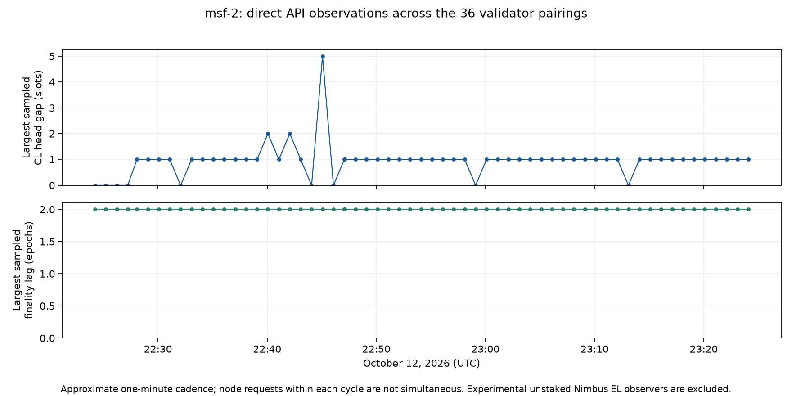

# msf-2 benchmark observations — October 12, 2026

The slow rollout completed at 22:18 UTC: Geth v1.17.8, Teku 26.10.0 and Lodestar v1.50.0 are deployed, with the image pins committed and pushed in [38d17fa](https://github.com/ethpandaops/glamsterdam-devnets/commit/38d17facf7691eefd79b8af941c2b430163c8630). The network continues finalizing. Four failures deserve focused client investigation, and one restart-recovery symptom needs an interoperability test.

The completed read-only observation window is **22:24:13–23:24:13 UTC**. The reports also preserve earlier incidents from this same benchmark and the rollout; their timestamps distinguish them from new monitoring-window events. The observation window has ended; the overall benchmarking run may continue.

## Issues worth client-team review

Priorities below are investigation recommendations, not maintainer-assigned severity ratings.

| Report | Team | Priority | Evidence and current state |
|---|---|---|---|
| [Heap exhaustion and Engine delays](01-besu-heap-exhaustion.md) | Besu | High | Four pairings terminated with Java heap OOM before monitoring; automatic restarts recovered them. Additional Engine timeouts, temporary head lag and late proposal attempts affected Lighthouse–Besu and Grandine–Besu during monitoring. |
| [Persisted envelope prevents startup](02-teku-persisted-envelope.md) | Teku | High | A stored zero parent hash disagrees with the canonical slot-2559 envelope. Repeated startup failure recovered through a checkpoint restore; the failing beacon database is preserved on the host. |
| [Engine listener stops serving requests](03-nimbus-engine-listener.md) | Nimbus EL | High | Independent authenticated Engine reads time out, with the internal accept queue at 101/100; ordinary RPC still answers. Outage remains present on an unstaked observer. |
| [Optimistic recovery delays](04-teku-optimistic-recovery.md) | Teku, Lodestar, Geth, Erigon | Medium | Teku's Geth/Erigon pairings skipped duties during rollout. Teku–Erigon and Lodestar–Erigon later became optimistic without a restart and recovered unaided; Teku skipped another 31 attestations. |
| [Local payload failure prevents remote-bid proposals](05-nimbus-remote-bid-fallback.md) | Nimbus CL; Reth timing follow-up | High | Nimbus–Reth missed all 12 assigned proposer duties in completed epochs 88–96 despite validated pre-slot external bids. The deployed CL returns before remote selection when local getPayload times out. |

Each report includes version and configuration context, exact evidence, impact, uncertainty, and a proposed private reproduction. None claims a successful fresh controlled reproduction or a proven latest-trunk fix. Reports are prepared for review; no upstream issue or client-team message has been sent.

[Structured client follow-ups](client-followups.json) record the evidence, confidence, reproduction status, next action and acceptance conditions for each investigation.

## Observation results

The collector retained **62 records and 2,542 host checks**, including the brief reload overlap described below. Reference finality advanced from **epoch 85 to 95**. The 36 validator pairings stayed two epochs behind their sampled heads for finality, and all 36 were synced and execution-valid in the final cycle. There were **no recorded container lifecycle changes**, API collection errors, or same-slot disagreements among nodes reporting validated, online heads. This does not establish uninterrupted health between samples or successful proposer duties.

One Besu execution metrics scrape failed. The largest sampled validator head gap was five slots on Lighthouse–Besu; its own API reported a four-slot sync distance in that cycle, whose node requests were not simultaneous. The [hour-bounded critical log sweep](evidence/monitoring-critical-log-sweep.json) found no additional OOM, fatal, panic or state-root-mismatch signatures. Intermittent Engine delays and skipped duties are described in the issue reports.

The completed-epoch census covers **epochs 88–96: 288 slots, with 16 missing canonical slots**. Partial epochs at the hour's boundaries are excluded. This is an observational duty census, not a controlled cross-client ranking.

| Pairing | Missing canonical slots | Assigned duties in census |
|---|---:|---:|
| Nimbus–Reth | 12 | 12 |
| Grandine–Besu | 2 | 9 |
| Lighthouse–Besu | 1 | 11 |
| Lodestar–Erigon | 1 | 9 |

All other matrix pairings had no missing canonical slots in this census. Some missing slots had late attempted broadcasts; missing canonical data is not proof that no block was signed. The [derived monitoring summary](evidence/monitoring-summary.json) lists every slot, proposer and source interval. [summarize.py](summarize.py) rebuilds it from saved evidence.

## Network and workload

This is a Gloas/Amsterdam shadowfork from the jochemnet release snapshot at execution block **24452538**, with a **200-million-gas limit**, **12-second slots**, **32-slot epochs**, and **36,000 validators** across 36 client pairings. Two Nimbus EL observers, two builders and the bootnode bring SSH coverage to 41 hosts. The snapshots do not replay mainnet transactions. Configuration and image pins are in [the msf-2 inventory](../../ansible/inventories/msf-2/).

The [workload sample](workload.md) records an actual block and contract bytecode. At 22:42 UTC the sampled block used about 83.9 million gas and had five transactions walking ranges of deterministic contract addresses. One independently retrieved callee has 65,536 bytes of code. A 200-million-gas limit is the configured ceiling, not a claim that every observed block was full.

## Monitoring method and limits

The collector samples every 60 seconds: direct beacon sync/head/finality APIs and execution RPC on all 41 hosts; execution, beacon and validator container lifecycles; scoped Prometheus heap, GC, payload latency, gas, CPU steal and available-memory series; recent failure logs; and Dora finality. Node reads within one cycle are sequential per host and concurrent across hosts, so their capture times are not identical. Same-slot root comparisons exclude optimistic nodes.

Prometheus contains 40 host instances; the bootnode's absence from those series is a coverage gap, not evidence that the bootnode is down. Direct SSH/API checks include it. Log searches are bounded and selective. The initial broad filter reached its 120-row limit in the first four cycles, dominated by normal topic/metric text; this prevents an exhaustive log-absence claim for that interval. The filter was refined to remove that noise and include Engine timeout symptoms. Separate per-issue queries preserve the focused failure intervals. A brief overlap while reloading the collector produced two cycle-24 records about two seconds apart. The full timestamps are retained; records are not treated as independent minute-long exposures.

No client configuration, process restart, heap dump or execution trace was induced during this observation window. Earlier rollout interventions are described in the Teku reports. These observations cannot measure failure-free behavior between samples, isolate hardware differences, or establish a fair cross-client throughput ranking.

## Signals excluded from the issue list

Normal Nimbus `no proposers registered` messages, load-generator nonce/already-known errors, unsupported light-client topics, and unfinished-epoch participation figures do not establish client failures. Nimbus EL height zero and optimism during deliberately experimental cold snap sync also need configuration and progress context; the unresponsive Engine listener has separate service evidence. Besu transaction-selection `EXECUTION_INTERRUPTED` messages are budget interruptions, not proof that a canonical execution payload is invalid.

The [evidence directory](evidence/) retains exact scoped queries, source API responses, failure logs, and [compressed monitoring samples](evidence/observations.jsonl.gz). [plot.py](plot.py) rebuilds the figures from those saved responses. The report links primary release source where it supports a mechanism, and marks runtime attribution separately.
