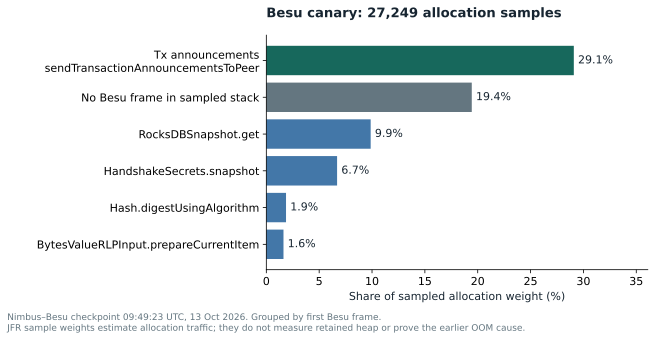
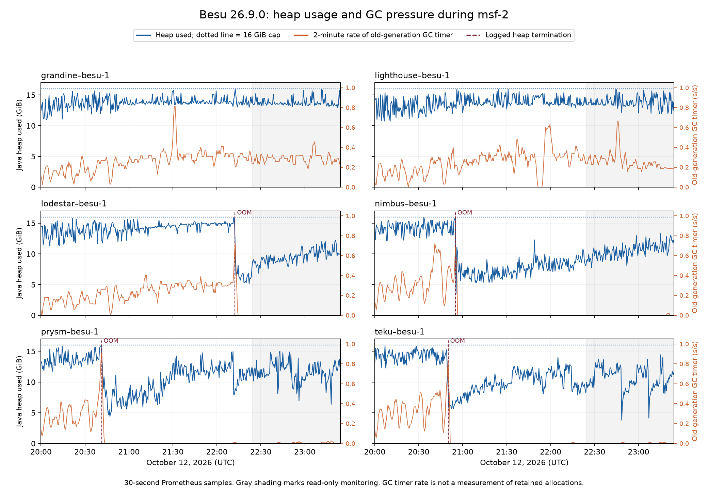

# Besu heap exhaustion during block processing

Besu 26.9.0 exhausted its Java heap on four client pairings during the msf-2 benchmark. The failures interrupt execution validation even though Docker restarts the process. This deserves Besu memory and garbage collection profiling under the benchmark workload.


## Why this warrants Besu engineering time

Four CL pairings independently exhausted an explicit **16 GiB Java heap** on the same released EL. This makes a single consensus-client integration or an undersized default heap an incomplete explanation. Automatic restart restored progress, but it also interrupted execution validation; the same observation window contains Engine timeouts and late Besu-backed proposals. Network-wide finality continuing does not remove this per-node availability cost.

The benchmark is useful because it separates the **200M gas ceiling** from the concrete load: five transactions walking thousands of distinct addresses, with large code present in the sampled state. This is a memory-scaling and response-latency case for Gloas/BAL execution, not a claim that every 200M-gas block fails. A larger heap may change the threshold without identifying an allocation or retention problem.

The follow-up for **#11248** now supplies an explicit heap budget, four release-image occurrences, GC/heap history and current allocation evidence. That narrows the next task: correlate a future OOM's retained objects with import/proposal allocation stacks, rather than start from an unexplained process exit. The first current canary recording already identifies concrete allocation sites to investigate; it does not identify the objects retained during the historical OOM.



The chart uses **27,249 samples** from a checkpoint ending at 09:49:23 UTC. Transaction announcements account for about 29.1% of its sampled allocation weight, with RocksDB reads another visible contributor. These are estimates of current allocation traffic, not retained heap, and the later txpool/workload conditions differ from the original OOM interval. [Sanitized allocation summary](../evidence/besu-allocation-sample.json).

A useful client-team outcome is bounded memory and timely Engine responses during sustained import plus proposal work. Use the captured workload and new profiles to compare allocation/retention across parallel execution and prefetch in an isolated run, changing one variable at a time.

## Profiling deployed on all six Besu pairings

OOM dump capture, rotating GC/safepoint logs and a named **default-settings JFR recording** are active on all six msf-2 Besu nodes. The rollout preserved Besu 26.9.0, the 16 GiB heap, live peer seeds and each beacon/validator container. Each node passed a canonical-head/finality health gate and produced a nonempty, parseable checkpoint with allocation samples. [Deployment evidence](../evidence/besu-profiling-rollout.json).

Every JVM start creates a unique timestamp/UUID directory under `/data/besu-profiling/runs`. JFR retains a rolling 30-minute / 256 MiB window; checkpoints capture up to five minutes / 64 MiB every five minutes. The collector normally retains 24 checkpoints and preserves runs containing an OOM heap dump. GC logs rotate at ten 50 MiB files per run. A 40 GiB free-space reserve is checked. Incident directories still need private archival and disk monitoring; heap dumps are not automatically deleted.

The private smoke test on the exact Java image generated an OOM dump before exit and a second dump in a distinct directory after restart. Live checkpoints validate recording capture; **they do not reproduce the historical Besu OOM or supply its retained-object graph**. [Pipeline test](../evidence/besu-profiling-pipeline-test.json). The JFR exit-file test showed why periodic checkpoints are needed instead of relying on `dumponexit` alone.

Raw HPROF/JFR artifacts remain private on the nodes because JVM memory can contain authentication material. This public report contains sanitized sample aggregates, figures and configuration. See the [profiling operations guide](../besu-profiling.md).

Lighthouse–Besu remained EL-offline briefly after its execution restart: Engine service was listening at 09:59:48, while Lighthouse logged Engine online at 10:03:44. The rollout held until it caught up and passed the health gate at 10:06:08. It recovered without a CL or proxy restart. This induced restart interval is not counted as another spontaneous heap failure or attributed to profiling overhead.

## Further investigation: released-runtime repeat of Besu issue 11248

**Issue type:** follow-up / release and workload variant of [Besu #11248](https://github.com/besu-eth/besu/issues/11248), which is open as checked on October 13. **Reproduction mode:** repeated live occurrences; no fresh controlled OOM reproduction. **Owner:** Besu. **Priority:** high for heap exhaustion under sustained load.

The existing upstream report concerns a development build and an approximately 8 GiB default heap. msf-2 supplies four independent released-image terminations with an explicit 16 GiB heap and automatic recovery. These differences warrant attaching this occurrence to that issue. They do not prove an identical retained-object mechanism.

The October 13 follow-up found:

- [All 41 nodes sampled at 08:18 UTC](../evidence/current-network.json); all validator pairings followed the head without optimism. Each of the four affected Besu containers still had exactly one restart, at its original failure time.
- [The bounded overnight OOM query](../evidence/overnight-oom.json), covering 23:24:13–08:30 UTC, returned no additional matching rows. This is log-query coverage, not continuous allocation profiling.
- At 08:31, [heap usage](../evidence/besu-heap-current.json) ranged from **11.6 to 13.8 GiB** across the six Besu pairings. [Two-minute old-generation GC rates](../evidence/besu-gc-current.json) were zero at that sample, unlike the high-pressure interval in the original graph.
- [A later reference block](../evidence/current-execution-block.json) used **19,326,828 gas across 1,288 transactions**, versus 83,881,805 gas across five transactions in the captured October 12 workload. A 200M gas *limit* does not mean the workload or allocation pressure stayed constant.
- [Six later-state code samples](../evidence/workload-code-samples.json), spread across the original input ranges, each contain 65,536 bytes and have distinct code hashes. Each embeds its own address at offset 44. The original historical-state request now fails because that state was pruned; these extra samples are explicitly from the later block recorded in the file. They supplement the one callee already captured at the original block, not a trace proving all inner CALLs succeeded.

### Source and competing explanations

The release is commit `ee9c64c8ed031cba5c6bcdb502a79c03c3a467c4`. Its [Bonsai code cache](https://github.com/besu-eth/besu/blob/ee9c64c8ed031cba5c6bcdb502a79c03c3a467c4/ethereum/core/src/main/java/org/hyperledger/besu/ethereum/trie/pathbased/bonsai/code/BonsaiCodeCache.java) uses a 256 MiB memory-bound cache. It is therefore inaccurate to describe this cache as simply unbounded. That cap does not bound transaction overlays, raw state/code buffers or simultaneously active proposal/import work.

The observed Engine stack reaches the release's [parallel transaction result wait](https://github.com/besu-eth/besu/blob/ee9c64c8ed031cba5c6bcdb502a79c03c3a467c4/ethereum/core/src/main/java/org/hyperledger/besu/ethereum/mainnet/parallelization/BalConcurrentTransactionProcessor.java). This waits on a future without a local timeout. [The fetched upstream comparison](../evidence/source-comparison.json) shows subsequent parallel-processing changes and a configurable timeout on main at `7e35f46ab6b78214f375f191ffc989b6cbc556c0`; trunk was not exercised on this failing workload. A timeout change alone is not evidence of an OOM repair.

| Hypothesis | Evidence and disposition |
|---|---|
| Host / Docker memory kill | Java explicitly reports heap exhaustion and exit 3; recorded Docker OOMKilled is false. A kernel kill is not the observed termination mechanism. |
| Unbounded shared Bonsai code cache | Rejected as a literal source description: the released cache has a weight cap. Other code copies may still consume heap. |
| Concurrent BAL / proposal work retains large code/state buffers | Plausible from stack, active workload and GC pressure; requires retained-object and allocation evidence. |
| Parallel execution deadlock causes the OOM | A waiting future is observed; no wait-cycle or allocation profile establishes this causal chain. |

**Smallest remaining client-team experiment:** preserve the pre-failure state and exact Engine payload/build inputs, run repeated import and proposal work privately with the same heap/CPU budget, and capture allocation plus post-GC retained memory. Compare sequential/parallel execution and prefetch with one variable changed at a time. Do not select block 24454848 as the crashing payload merely because it was the last completed import.

## Environment

`glamsterdam-msf-2` starts on Gloas and Amsterdam, using the jochemnet release snapshot at execution block 24452538. Slots last 12 seconds, and the scheduled gas limit is 200 million. Besu uses Bonsai, full sync, parallel transaction processing and BAL prefetch. [Live runtime configuration](https://github.com/ethpandaops/glamsterdam-devnets/blob/60a8cf5a3d76dc9a508c01e3a9412881d4c1440c/md/msf-2-benchmark-2026-10-12/evidence/besu-runtime-config.json) confirms `-Xmx16g -XX:MaxHeapFreeRatio=30 -XX:MinHeapFreeRatio=10` on all six pairings, each with eight host CPUs and approximately 63 GiB of host RAM. See the [network configuration](https://github.com/ethpandaops/glamsterdam-devnets/blob/60a8cf5a3d76dc9a508c01e3a9412881d4c1440c/ansible/inventories/msf-2/group_vars/all/all.yaml), [Besu configuration](https://github.com/ethpandaops/glamsterdam-devnets/blob/60a8cf5a3d76dc9a508c01e3a9412881d4c1440c/ansible/inventories/msf-2/group_vars/besu.yaml), and [deployment images](https://github.com/ethpandaops/glamsterdam-devnets/blob/60a8cf5a3d76dc9a508c01e3a9412881d4c1440c/ansible/inventories/msf-2/group_vars/all/images.yaml).

## Observed failures

All times are UTC on October 12, 2026. Duplicate copies of the same log event have been removed from this table.

| Node | Heap termination | Besu startup log |
|---|---|---|
| prysm-besu-1 | 20:41:21.476 | 20:41:24.413 |
| teku-besu-1 | 20:50:04.067 | 20:50:07.672 |
| nimbus-besu-1 | 20:55:01.162 | 20:55:04.186 |
| lodestar-besu-1 | 22:12:22.081 | 22:12:25.279 |

The common failure is:

```text
Terminating due to java.lang.OutOfMemoryError: Java heap space
```

[Occurrence query and raw results](https://github.com/ethpandaops/glamsterdam-devnets/blob/60a8cf5a3d76dc9a508c01e3a9412881d4c1440c/md/msf-2-benchmark-2026-10-12/evidence/besu-oom-occurrences.json) include the exact timestamps and the query needed to retrieve them. [Nimbus pairing execution logs](https://github.com/ethpandaops/glamsterdam-devnets/blob/60a8cf5a3d76dc9a508c01e3a9412881d4c1440c/md/msf-2-benchmark-2026-10-12/evidence/besu-heap-failure.log) preserve the surrounding failure and recovery.

Before the Nimbus pairing terminated, an Engine thread was blocked for 60,070 ms. Its stack was waiting for `BalConcurrentTransactionProcessor.getProcessingResult` during `EngineNewPayloadV5`. Block production also exceeded its five-second transaction selection budget. Nimbus CL reported a payload retrieval timeout at 20:53:37.572. These are consequences or correlated symptoms; the stack alone does not establish a parallel processing deadlock.

Docker reported exit code 3 and automatically restarted execution at 20:55:02.222. Backward sync completed at 20:55:57.616. The beacon process stayed running. The most recent completed payload import before the stall was at height 24454848; the stalled work's exact payload should be recovered from engine traces before selecting a single-block reproducer.

## Garbage collection evidence

The [heap history](https://github.com/ethpandaops/glamsterdam-devnets/blob/60a8cf5a3d76dc9a508c01e3a9412881d4c1440c/md/msf-2-benchmark-2026-10-12/evidence/besu-heap-history.json.gz) and [GC history](https://github.com/ethpandaops/glamsterdam-devnets/blob/60a8cf5a3d76dc9a508c01e3a9412881d4c1440c/md/msf-2-benchmark-2026-10-12/evidence/besu-gc-history.json.gz) cover 20:00–23:24 UTC at 30-second resolution. They preserve their full Prometheus commands. The largest observed two-minute rate of the old-generation GC timer on `prysm-besu-1` was approximately 0.918 seconds per second. The corresponding maxima on the other affected nodes ranged from approximately 0.721 to 0.848 seconds per second. These measurements support substantial GC pressure, rather than proving a particular retained object or leak.

During monitoring, `lighthouse-besu-1` experienced another responsiveness interruption around 22:44–22:45. Lighthouse logged getPayload and Engine upcheck timeouts, delayed slot-2906 broadcast by 2,044 ms, and rejected an envelope because its execution request timed out. A direct sample at 22:45 recorded a four-slot sync distance; the next minute's sample had caught up. Besu's execution metrics scrape also failed once. No process restart was recorded for this interval. The [bounded log capture](https://github.com/ethpandaops/glamsterdam-devnets/blob/60a8cf5a3d76dc9a508c01e3a9412881d4c1440c/md/msf-2-benchmark-2026-10-12/evidence/lighthouse-besu-slow-imports.json) includes subsequent 5.6-second imports and a blocked Vert.x event-loop warning. This adds live service degradation evidence without proving it shares the OOM's precise internal cause.

An earlier [slot-2885 capture](https://github.com/ethpandaops/glamsterdam-devnets/blob/60a8cf5a3d76dc9a508c01e3a9412881d4c1440c/md/msf-2-benchmark-2026-10-12/evidence/lighthouse-besu-slot2885.json) shows Engine timeouts and delayed proposer preparation on the same pairing. Lighthouse broadcast its local block **6,075 ms late** at 22:40:06.092; both the reference header check and Dora's completed-epoch records classify the canonical slot as missing. This was a late attempted proposal, not evidence that the validator never signed or broadcast a block. Its exact propagation and fork-choice path has not been reconstructed.

At slot **2977**, Grandine–Besu also published a builder-backed beacon block late, at **22:58:27.154** (approximately 3.154 seconds into the slot), following a local Engine request error and proposal restart. [The focused capture](https://github.com/ethpandaops/glamsterdam-devnets/blob/60a8cf5a3d76dc9a508c01e3a9412881d4c1440c/md/msf-2-benchmark-2026-10-12/evidence/grandine-besu-slot2977.json) includes Besu's five-second selection interruption and Grandine's eventual block publication. The completed epoch-93 census classifies the canonical slot as missing. That timing is correlated with local execution delay; the capture does not isolate all propagation or fork-choice causes of the absent canonical block.



The [captured workload](https://github.com/ethpandaops/glamsterdam-devnets/blob/60a8cf5a3d76dc9a508c01e3a9412881d4c1440c/md/msf-2-benchmark-2026-10-12/workload.md) contains five transactions walking thousands of deterministic contract addresses; one sampled callee has 64 KiB of code. Use that concrete code/state context for allocation profiling, while recovering the exact stalled payload independently.

## Assessment and next client work

**Suggested priority: high. Confidence: high in heap exhaustion and service disruption; medium in the deeper allocation or retention mechanism.** A 16 GiB heap budget is part of the reproduction conditions. Larger heap sizing could change the result; this observation does not establish that Besu would fail with every memory budget.

Profile allocation and retained memory during both transaction selection and BAL execution on this snapshot and load. Preserve heap sizing, CPU allocation and actual transaction inputs, then compare a larger heap with the current cap. Check whether parallel import and proposal construction retain duplicate code/state buffers. A successful repair should preserve Engine responsiveness under sustained load and repeated proposals, without progressive heap growth or full-GC saturation.

The four live failures establish a repeated released-runtime symptom, **not** a fresh controlled reproduction. No heap dump or allocation profile was collected during the observation window, because those operations could perturb the benchmark.

[Besu issue 10283](https://github.com/besu-eth/besu/issues/10283) describes an earlier snap-sync OOM on a different build and an 8 GiB heap. It is useful background, but does not establish that this full-sync, post-Amsterdam workload is the same defect.

## Rechecking the evidence

```bash
panda clickhouse query-raw clickhouse-raw "SELECT Timestamp, ResourceAttributes['host.name'] AS host, Body FROM external.otel_logs WHERE ResourceAttributes['network']='glamsterdam-msf-2' AND ResourceAttributes['container.name']='execution' AND Timestamp >= toDateTime('2026-10-12 20:40:00') AND Timestamp < toDateTime('2026-10-12 22:13:00') AND Body LIKE '%OutOfMemoryError%' ORDER BY Timestamp ASC LIMIT 40"
panda prometheus query-range devnets 'jvm_memory_used_bytes{network="glamsterdam-msf-2",job="execution",area="heap"}' --start 2026-10-12T20:00:00Z --end 2026-10-12T23:24:13Z --step 30s
panda prometheus query-range devnets 'rate(jvm_gc_collection_seconds_sum{network="glamsterdam-msf-2",job="execution"}[2m])' --start 2026-10-12T20:00:00Z --end 2026-10-12T23:24:13Z --step 30s
```
