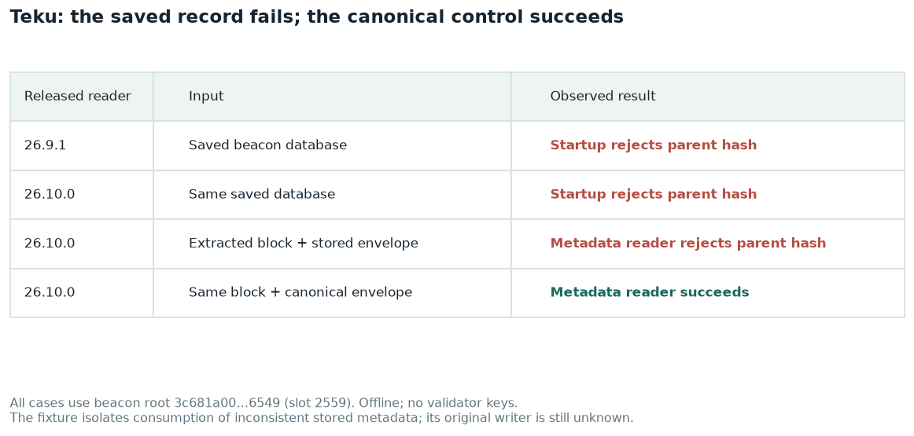

# Teku rejects a persisted payload envelope during restart

Teku 26.9.1 and 26.10.0 both fail to restart from a saved msf-2 beacon database containing an inconsistent blinded payload envelope. The same stored block passes metadata reconstruction with its independently fetched canonical envelope. A portable fixture reproduces the reader failure; the original record-creation path remains unresolved.


## Why this warrants Teku engineering time

This is a **restart availability failure for a node with 1,000 validators**, not merely an optimistic status warning. Both released readers reject the same persisted record before the node can resume normal operation. Recovery required a fresh beacon database and checkpoint restoration; validator keys and slashing protection were preserved, but ordinary restart could not recover the node.

The positive control is the main reason this is efficient to triage: **the same stored beacon block succeeds with the canonical envelope and fails with the saved envelope**. The small SSZ fixture and supplied runner reproduce consumption of the bad record without validator keys, the original 147 MiB database, peers, an EL or the benchmarking infrastructure. Both older and newer released readers fail on the saved database, so an upgrade-only theory should not divert the investigation.



The remaining work is narrow: find the writer or incomplete-payload path that persisted the default-looking header, and prevent an inconsistent record from making subsequent startup unrecoverable. Keep the commitment validation; add a fixture-based storage-restart regression and a writer-path test once creation is isolated. This is high priority for local node availability, with no evidence here of a network-wide finality failure or a signing/slashing failure.

## Further investigation: isolated restore and portable record reproduction

**Issue type:** reproducible stored-envelope inconsistency. **Owner:** Teku storage / ePBS. **Priority:** high because the saved database cannot start. **Reproduction mode:** private restore with no network or validator material, followed by a standalone extracted-record test using the actual released Teku classes.

A read-only copy of the inactive saved beacon database reproduced the **same root and parent-hash exception** with both **26.9.1** and **26.10.0**. Each private container had `--network none`, no validator keys, 2 CPUs, an 8 GiB memory cap and a 4 GiB Java heap; both exited 1 with OOMKilled=false. [Run metadata](../evidence/teku-private-reproduction.json) records images, image IDs, start/end timestamps and arguments. [26.9.1 log](../evidence/teku-private-startup-26.9.1.log) and [26.10.0 log](../evidence/teku-private-startup-26.10.0.log) preserve the startup failures.

**Do not call this a new 26.10.0 reader regression.** The relevant `StoredBlockMetadata.java` files in the two tags have identical SHA-256 `2a9786c3aab199f2a9c87a2a681c2400ca8b0e9bf6d6bf3ce38e35345337f694`. This still does not identify when the inconsistent record was written.

### Direct inspection of the saved record

RocksDB was opened read-only. The key is the exact 32-byte beacon root. [The inspection transcript](../evidence/teku-record-inspection.log) identifies column-family byte `0x92` and an **824-byte serialized blinded envelope**. Teku's own deserializer reads:

| Stored field | Value |
|---|---|
| Beacon root | `0x3c681a001b2ec71bf23d98c8b1b963b756d53477cb9a4daa52f65c71f25c6549` |
| Payload parent hash | all zero |
| Payload block hash | `0x65a17c8257288fc4b3cc7ff8b5d986401606709c5cc6aa005ff4072479cce7e9` |
| Payload block number | 0 |
| Payload gas limit | 0 |
| Header-derived slot | 0; the associated beacon block's slot is 2559 |

The canonical parent and execution hashes are absent from the raw stored bytes. This is not merely a misleading startup log. The cause of the default-looking payload fields remains unresolved; no claim is made that gossip validation accepted this exact record or that a particular writer was observed creating it.

### Minimal reproduction and positive control

The public fixtures are [stored beacon block](../evidence/teku-slot2559-stored-block.ssz), [stored blinded envelope](../evidence/teku-slot2559-stored-envelope.ssz), and [canonical signed envelope](../evidence/teku-slot2559-canonical-envelope.ssz). They contain public chain data. The full database and node-key directory are excluded.

[CheckStoredRecord.java](../tests/CheckStoredRecord.java) calls the real `StoredBlockMetadata.extractGloasForkChoiceRebuildData`:

1. Saved block + saved blinded envelope reproduces the exact parent-hash exception.
2. The **same saved block** + canonical envelope blinded by Teku succeeds, yielding execution block **24455040** and gas limit **200000000**.

[The test transcript](../evidence/teku-minimal-reproduction.log) records both outcomes. From an extracted evidence ZIP, run:

```bash
TEKU_REPRO_JAVAC=/path/to/jdk25/bin/javac bash tests/teku_reproduce.sh .
```

Docker and a JDK 25 compiler are required. [The script](../tests/teku_reproduce.sh) obtains libraries from the selected released image and runs offline without validators. It reproduces consumption of the bad record, not the original creation sequence.

| Hypothesis | Result |
|---|---|
| Only the 26.10.0 reader rejects this database | Rejected by the 26.9.1 private restore and identical validation source. |
| Canonical slot 2559 really has a zero-parent payload | Rejected by independent canonical data and the positive control. |
| The saved local envelope contains inconsistent payload metadata | Confirmed by raw record inspection and the actual reader. |
| A specific serialization, placeholder or optimistic-import writer created it | Still open; record extraction cannot identify its writer history. |

The release [storage writer](https://github.com/Consensys-Incorporated/teku/blob/a46f9e1e3679e4c2707d27447628d07a6c67b600/storage/src/main/java/tech/pegasys/teku/storage/store/StoreTransactionUpdatesFactory.java) blinds hot execution envelopes, while the [serializer](https://github.com/Consensys-Incorporated/teku/blob/a46f9e1e3679e4c2707d27447628d07a6c67b600/storage/src/main/java/tech/pegasys/teku/storage/server/kvstore/serialization/SignedBlindedExecutionPayloadEnvelopeSerializer.java) writes SSZ directly. These are candidate paths, not runtime attribution.

[Upstream #11153](https://github.com/Consensys-Incorporated/teku/issues/11153) concerns zero-hash Gloas fork-choice status; [#11246](https://github.com/Consensys-Incorporated/teku/issues/11246) concerns envelope-range selection. Neither title establishes a duplicate of this exact record/startup failure. A bounded upstream search found no exact matching report; it is not an exhaustive guarantee.

**Client-team request:** trace creation and persistence of incomplete/default payload headers; add a storage restart regression using these fixtures and a writer-path regression once isolated. Keep the mismatch validation. A recovery strategy should repair/refetch inconsistent metadata without silently accepting mismatching execution commitments.

## Environment and impact

The node runs 1,000 validators on `glamsterdam-msf-2`, a mainnet-preset network starting on Gloas and Amsterdam. Teku was upgraded from 26.9.1 to 26.10.0 at approximately 21:36 UTC on October 12, 2026. Its execution client remained Erigon v3.7.1. See the [image pins](https://github.com/ethpandaops/glamsterdam-devnets/blob/60a8cf5a3d76dc9a508c01e3a9412881d4c1440c/ansible/inventories/msf-2/group_vars/all/images.yaml) and [validator allocation](https://github.com/ethpandaops/glamsterdam-devnets/blob/60a8cf5a3d76dc9a508c01e3a9412881d4c1440c/ansible/inventories/msf-2/inventory.ini).

The initial upgrade left the node optimistic. A subsequent beacon restart exposed the storage failure and a restart loop. This made the node's validators unavailable until recovery. Network-wide finality continued.

## Exact failure and independent block evidence

[Preserved startup logs](https://github.com/ethpandaops/glamsterdam-devnets/blob/60a8cf5a3d76dc9a508c01e3a9412881d4c1440c/md/msf-2-benchmark-2026-10-12/evidence/teku-startup-failure.log) show the exception repeatedly:

```text
Blinded execution payload envelope parent block hash 0x0000000000000000000000000000000000000000000000000000000000000000 does not match GLOAS block bid parent block hash 0x04da4849f769bf233751505c809d291d8ab70f91cccdcd46909b4bb55c649f7b for block root 0x3c681a001b2ec71bf23d98c8b1b963b756d53477cb9a4daa52f65c71f25c6549
```

The stack reaches `StoredBlockMetadata.getValidatedPayloadHeader`, `extractGloasForkChoiceRebuildData`, `KvStoreDatabase.buildHotBlockMetadata`, and `createMemoryStore`. This places the failure in reconstruction of stored hot-block metadata during startup, before normal validator operation resumes.

The affected root is beacon slot **2559**, execution block **24455040**, with builder registry index **0**. Slot 2559 began at **21:34:48 UTC**, before the approximately 21:36 upgrade. That establishes the block's age, not when the failing local metadata was written or converted. The [canonical beacon block](https://github.com/ethpandaops/glamsterdam-devnets/blob/60a8cf5a3d76dc9a508c01e3a9412881d4c1440c/md/msf-2-benchmark-2026-10-12/evidence/teku-slot2559-block.json) commits to:

| Field | Value |
|---|---|
| Parent execution hash | `0x04da4849f769bf233751505c809d291d8ab70f91cccdcd46909b4bb55c649f7b` |
| Execution hash | `0x1cc802c819736d0a4b484f814d563e63c891fbb5dcb7b0a2f515ab7c097eb7dd` |
| Gas limit | 200000000 |

The [signed envelope retrieved from teku-nethermind-1](https://github.com/ethpandaops/glamsterdam-devnets/blob/60a8cf5a3d76dc9a508c01e3a9412881d4c1440c/md/msf-2-benchmark-2026-10-12/evidence/teku-slot2559-envelope.json) has those same parent and execution hashes. Thus, a globally unavailable or zero-parent payload does not explain this local startup exception. This does not prove when or how the local stored header became inconsistent.

## Timeline

All times below are UTC on October 12, 2026. The [rollout timeline](https://github.com/ethpandaops/glamsterdam-devnets/blob/60a8cf5a3d76dc9a508c01e3a9412881d4c1440c/md/msf-2-benchmark-2026-10-12/evidence/rollout-timeline.log) and [initial optimistic-startup logs](https://github.com/ethpandaops/glamsterdam-devnets/blob/60a8cf5a3d76dc9a508c01e3a9412881d4c1440c/md/msf-2-benchmark-2026-10-12/evidence/teku-optimistic-startup.log) preserve the original observations.

| Time | Event |
|---|---|
| 21:36–21:38 | Updated Teku starts, follows beacon head, and stays optimistic while execution returns SYNCING |
| Around 21:40 | Beacon restart attempted after execution imports; storage initialization begins failing |
| 21:41 | Repeated startup exceptions identify the same root and zero parent hash |
| 21:43 | Beacon database preserved; fresh beacon starts from a canonical finalized SSZ state |
| 21:50 | Node exits optimistic mode and resumes validator duties after additional engine recovery |
| 21:51–21:56 | Temporary initial-state option removed; a further restart succeeds and health checks pass |

The preserved beacon database is on the node at `/data/teku/beacon.before-release-recovery-20261012`. Validator data under `/data/teku/validator` and keys under `/data/teku-validator` were retained. The recovery sequence included both checkpoint restoration and execution-engine intervention; it is not an isolated test of one fix.

## Assessment and next client work

**Suggested priority: high. Confidence: high in the startup failure and stored-header disagreement; medium in its creation mechanism.** The original occurrence is now backed by the private restores and extracted-record control above. It does not prove that the version upgrade introduced the defect.

[The 26.10.0 source](https://github.com/Consensys-Incorporated/teku/blob/26.10.0/storage/api/src/main/java/tech/pegasys/teku/storage/api/StoredBlockMetadata.java) checks the envelope's root, parent hash, block hash and gas limit against the beacon bid during metadata reconstruction. The observed stack reaches that check. The unresolved question is the writer or conversion path that supplied the zero header.

The isolated inspection and canonical comparison are complete; now trace how the stored record was created. Check serialization round trips and the handling of optimistic, incomplete and pre-upgrade envelopes. Add a restart regression test using this storage record. Preserve the validation checks: repairing or refetching inconsistent metadata must not accept a mismatching payload.

## Rechecking the evidence

```bash
panda dora slot glamsterdam-msf-2 2559
ssh glamsterdam-msf-2-teku-nethermind-1 'curl -fsS http://127.0.0.1:5052/eth/v2/beacon/blocks/2559'
ssh glamsterdam-msf-2-teku-nethermind-1 'curl -fsS http://127.0.0.1:5052/eth/v1/beacon/execution_payload_envelopes/2559'
panda clickhouse query-raw clickhouse-raw "SELECT Timestamp, Body FROM external.otel_logs WHERE ResourceAttributes['network']='glamsterdam-msf-2' AND ResourceAttributes['host.name']='teku-erigon-1' AND ResourceAttributes['container.name']='beacon' AND Timestamp >= toDateTime('2026-10-12 21:40:00') AND Timestamp < toDateTime('2026-10-12 21:43:00') AND Body LIKE '%Blinded execution payload envelope parent block hash%' ORDER BY Timestamp ASC LIMIT 20"
```
