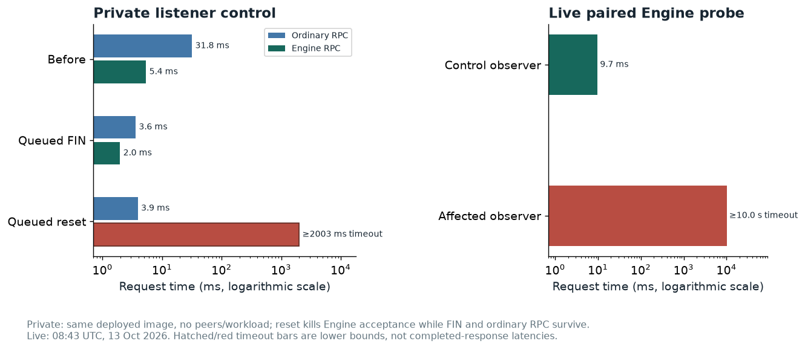

# Nimbus execution Engine API listener stops serving requests

`nimbus-nimbusel-1` has a persistent outage of its Engine API listener while ordinary execution RPC, peer activity and the process remain live. The engine listener's internal accept queue is full. This adds runtime evidence to the Nimbus HTTP accept-loop failure class investigated on devnet-8. The private experiment below confirms the reset/identification mechanism; the initiating live event remains untraced.


## Why this warrants Nimbus EL engineering time

The private test reproduces the availability failure **without Gloas traffic, peers or payload construction**. A queued TCP reset permanently ends acceptance on one HTTP listener while the process and the other listener keep working. That makes this a general RPC transport-resilience problem, not only an artifact of an unusually heavy execution workload.

The live msf-2 occurrence disables the **Engine** listener rather than ordinary RPC: the internal accept queue stays full and authenticated requests time out for hours. These nodes are unstaked observers, so this report does not claim lost validator duties. For a validator-backed deployment, however, losing Engine communication removes the paired CL's ability to validate execution. A process-up or ordinary-RPC-only health check cannot detect this failure mode.



For the existing **#4923** discussion, the report adds an Engine-only occurrence, a same-image reset/FIN control and the exact failing syscall. The bounded repair target is the accepted-transport identification failure: close that connection and keep accepting clients. The regression should verify subsequent authenticated Engine requests, ordinary RPC and process health separately. The initiating live reset was not captured; the private experiment establishes the mechanism independently.

## Further investigation: confirmed private failure mechanism, known upstream issue

**Issue type:** occurrence follow-up to open [Nimbus EL #4923](https://github.com/status-im/nimbus-eth1/issues/4923). **Owner:** Nimbus EL RPC / transport. **Reproduction mode:** live read-only verification plus fresh minimal listener fault injection on the same released image. **Network impact:** this pairing is an observer with no validators.

The [October 13 paired probe](../evidence/nimbus-engine-morning-probe.json) again tests authenticated `engine_exchangeCapabilities`. The affected Engine listener times out after about ten seconds, while the Lighthouse–Nimbus EL observer answers quickly. The affected listener's internal queue remains **101/100**, with ordinary RPC's queue **0/100**. The [08:18 network snapshot](../evidence/current-network.json) still reports this observer's EL offline, with no execution restart. No live restart or FCU/build/getPayload injection was performed.

### Fresh private reproduction with a disconnect control

[The test](../tests/nimbus_listener.py) used `statusim/nimbus-eth1:v0.4.2`, image ID `sha256:5af7d6b22e8de087c74f342db41ea1325e74a9b299d3a5358b0b83bec465b53e`, on a disposable Docker **internal** network. It had no peers, validators or benchmarking traffic. It uses mainnet genesis: this is a transport resilience test, not a Gloas-workload reproduction.

A short pause lets a client disconnect while its connection is queued for acceptance. Pause/unpause was applied **only to the disposable local container**.

| Stage | Ordinary RPC 8545 | Engine 8551 |
|---|---|---|
| Before injection | answers | answers in 5.4 ms |
| Queued FIN disconnect | answers | answers in 2.0 ms |
| Queued TCP reset | answers in 3.9 ms | times out at 2.0 s |

[Recorded results](../evidence/nimbus-private-listener-test.json) include timestamps and assert the process stays running. [The syscall trace](../evidence/nimbus-private-accept.trace) shows acceptance on Engine FD 17, followed by `getpeername` returning `ENOTCONN`; subsequent acceptance on ordinary RPC FD 16 continues, with no later acceptance on FD 17 during the trace window.

The exact release [accept loop](https://github.com/status-im/nimbus-eth1/blob/705f4d9aced29de0049d7ad5f686b0e585f3f38d/execution_chain/rpc/rpc_server.nim#L274) stops after identification fails. The **entire file is unchanged** on fetched master `831663a27c9fa845197ee13a0a9f289cf2fee940`, as recorded in [the source comparison](../evidence/source-comparison.json). No fixed trunk binary was tested.

| Hypothesis | Result |
|---|---|
| Engine JWT / method / fork mismatch | The same authenticated method works before injection and on the live control observer. The reset-induced private failure is acceptance failure, before method handling. |
| Whole process or every HTTP listener is dead | Rejected by ordinary RPC and the running process. |
| A short payload-build stall alone explains the persistent outage | Not established for this unstaked observer; the private test reproduces the failure without building anything. |
| A reset accepted before peer identification ends this listener's loop | Confirmed in the private experiment; consistent with live queue and split-listener symptoms. The historical live reset itself was not traced. |

Treat this report as another occurrence of #4923 rather than a new root-cause issue. The new variant is a long-lived **Engine-only** outage on msf-2. A fix should close only the failed transport and continue accepting other clients. Repeat the supplied FIN/RST control and separately check authenticated Engine completion, ordinary RPC completion and process health.

To rerun, create only the named disposable container shown below, then execute the attached test. It leaves the failed container for inspection; stop/remove only this container afterwards.

```bash
docker network create --internal msf2-investigation
docker run -d --name msf2-nimbus-rst-repro --network msf2-investigation   --cpus 2 --memory 2g statusim/nimbus-eth1:v0.4.2 executionClient   --data-dir=/tmp/case --discv5=false --rpc --http-address=0.0.0.0   --engine-api --engine-api-address=0.0.0.0 --log-level=DEBUG --log-format=nocolors
python3 tests/nimbus_listener.py
```

## Environment and scope

The execution client is Nimbus v0.4.2, build `705f4d9a`, paired with Nimbus consensus v26.10.0 on `glamsterdam-msf-2`. The container started at 12:53:22 UTC on October 12 and had zero recorded restarts during the initial checks. Both Nimbus execution observers are deliberately configured for experimental snap sync from an empty database, with static shadowfork peers and discovery disabled. They hold no validator allocation. See [Nimbus execution configuration](https://github.com/ethpandaops/glamsterdam-devnets/blob/60a8cf5a3d76dc9a508c01e3a9412881d4c1440c/ansible/inventories/msf-2/group_vars/nimbusel.yaml) and [inventory](https://github.com/ethpandaops/glamsterdam-devnets/blob/60a8cf5a3d76dc9a508c01e3a9412881d4c1440c/ansible/inventories/msf-2/inventory.ini).

Execution height zero during that sync is insufficient by itself to establish a defect. The distinguishing evidence is that independent lightweight Engine requests cannot be served, while the other RPC listener answers.

## Runtime evidence

The [onset query](https://github.com/ethpandaops/glamsterdam-devnets/blob/60a8cf5a3d76dc9a508c01e3a9412881d4c1440c/md/msf-2-benchmark-2026-10-12/evidence/nimbus-engine-outage-onset.json) finds the last completed engine requests in its 15:35–15:39 UTC window:

```text
DBG 2026-10-12 15:35:50.633+00:00 Processed JSON-RPC request                 topics="jsonrpc router" id=ok(1614) methodName=engine_newPayloadV5 len=66
DBG 2026-10-12 15:35:50.697+00:00 Processed JSON-RPC request                 topics="jsonrpc router" id=ok(1615) methodName=engine_forkchoiceUpdatedV4 len=101
```

At 15:39:10.995, the CL logged `Connection to EL node degraded`, `failedRequest=newPayload`, and `Request timed out`. Later [execution status samples](https://github.com/ethpandaops/glamsterdam-devnets/blob/60a8cf5a3d76dc9a508c01e3a9412881d4c1440c/md/msf-2-benchmark-2026-10-12/evidence/nimbus-snap-current.json) still reported `syncState=idle`, target 24453294, and a last-FCU age exceeding six hours.

An authenticated loopback `engine_exchangeCapabilities` request timed out after **10.018 seconds**. On the other observer, `lighthouse-nimbusel-1`, the same read-only method returned in **0.009 seconds**. [Probe results](https://github.com/ethpandaops/glamsterdam-devnets/blob/60a8cf5a3d76dc9a508c01e3a9412881d4c1440c/md/msf-2-benchmark-2026-10-12/evidence/nimbus-engine-capabilities.json) retain the response and timing; the probe's approximate capture time is explicitly identified in that file. No build or fork-choice request was injected during these checks.

A [repeat probe at 23:22 UTC](https://github.com/ethpandaops/glamsterdam-devnets/blob/60a8cf5a3d76dc9a508c01e3a9412881d4c1440c/md/msf-2-benchmark-2026-10-12/evidence/nimbus-engine-capabilities-final.json) again timed out on `nimbus-nimbusel-1` after **10.011 seconds**, while the other observer responded in **0.010 seconds**. Regular execution RPC and the process remained responsive in the monitoring samples.

[Socket evidence](https://github.com/ethpandaops/glamsterdam-devnets/blob/60a8cf5a3d76dc9a508c01e3a9412881d4c1440c/md/msf-2-benchmark-2026-10-12/evidence/nimbus-engine-sockets.txt) is from **inside** the execution container, not only Docker's host-side proxy. Its `/proc/net/tcp` listener on hexadecimal port `2167` (8551) has `rx_queue=00000065` (101), while port `2161` (8545) has a zero queue. A [network-namespace check at 22:40:34 UTC](https://github.com/ethpandaops/glamsterdam-devnets/blob/60a8cf5a3d76dc9a508c01e3a9412881d4c1440c/md/msf-2-benchmark-2026-10-12/evidence/nimbus-engine-accept-queue.txt) independently reports `LISTEN 101 100` for 8551 and `LISTEN 0 100` for 8545. Host-side Docker proxy queues remained empty and would have hidden this distinction.

The regular execution RPC responds to block-number and peer-count reads. The CL continues following the beacon chain optimistically and reports `el_offline=true`. This is an execution-validation outage on an unstaked observer; it does not explain network-wide finality loss.

## Assessment and duplicate handling

**Suggested priority: high for listener supervision and service health. Confidence: high in the persistent engine-listener outage; medium in the precise internal exit cause.** The full queue, timed-out independent request, stale engine activity and responsive other listener narrow the failure below the external proxy. They do not introspect the listener's accept future.

[The deployed release source](https://github.com/status-im/nimbus-eth1/blob/705f4d9aced29de0049d7ad5f686b0e585f3f38d/execution_chain/rpc/rpc_server.nim) contains an accept-loop exit on an accepted transport identification error. That source path is a candidate mechanism, not a demonstrated trigger in this run. The prior devnet-8 investigation found both RPC listeners affected on the same release; this occurrence supplies a variant with only the Engine listener visibly blocked.

Capture accept-loop completion reasons and verify that an individual connection failure cannot permanently stop later acceptance. Use the supplied private regression, then repeat it against a proposed fix. Service health should test request completion separately for execution RPC and Engine RPC.

[Issue 4881](https://github.com/status-im/nimbus-eth1/issues/4881) concerns slow synchronous payload construction. This observer has no validator or builder duties, and the captured engine silence lasts hours. A short build stall has not been established as the cause of this listener outage.

## Rechecking the evidence

```bash
ssh glamsterdam-msf-2-nimbus-nimbusel-1 'docker exec execution cat /proc/net/tcp'
ssh glamsterdam-msf-2-nimbus-nimbusel-1 'curl -fsS http://127.0.0.1:5052/eth/v1/node/syncing'
panda clickhouse query-raw clickhouse-raw "SELECT Timestamp, Body FROM external.otel_logs WHERE ResourceAttributes['network']='glamsterdam-msf-2' AND ResourceAttributes['host.name']='nimbus-nimbusel-1' AND ResourceAttributes['container.name']='execution' AND Timestamp >= toDateTime('2026-10-12 15:35:00') AND Timestamp < toDateTime('2026-10-12 15:39:00') AND Body LIKE '%engine_%' ORDER BY Timestamp DESC LIMIT 30"
```

The observation window is read-only. The node was not restarted or reconfigured to prove a recovery or re-induce the failure.
