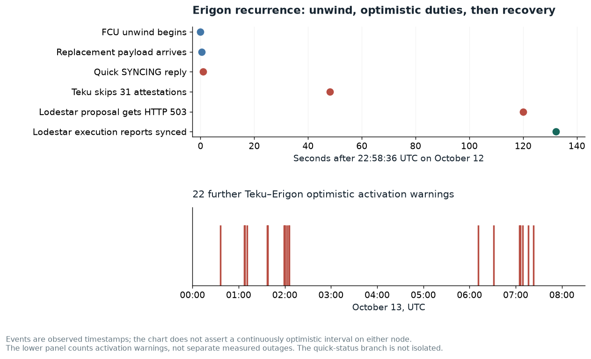

# Optimistic recovery delays during rollout and live operation

During the release rollout, Teku 26.10.0 on the Geth and Erigon pairings followed the beacon head but remained optimistic for several minutes and skipped validator attestations. The ELs continued importing canonical execution blocks while Engine interactions returned SYNCING. During later read-only monitoring, both Teku–Erigon and Lodestar–Erigon temporarily returned to optimism without a restart. This is worth a focused synchronization and recovery test with the consensus and execution-client teams; the current evidence does not identify a single faulty component.


## Why this warrants Erigon and CL interoperability time

The initial recurrence affects **two independent external consensus clients sharing Erigon 3.7.1**, without an operator restart. It spans an execution unwind, repeated SYNCING replies, skipped Teku duties and a Lodestar assigned proposal rejected with HTTP 503. Both pairings have 1,000 validators. A protocol-valid SYNCING response can still have a substantial validator-performance cost when recovery extends across proposal deadlines.

The overnight follow-up supplies **22 further Teku optimistic activation warnings** after rollout. This makes startup-only explanations insufficient and gives the team repeated timestamps to trace. The warning count is not a count of measured outage durations, and the later query does not show every episode affecting Lodestar as well.



This is worth a bounded **recovery latency investigation**, rather than a claim that Erigon violates Engine semantics. The report provides the parent/replacement hashes and arrival order; both initial quick newPayload replies take approximately the released 500 ms readiness budget. Instrument that branch and replay the overlap privately to distinguish execution readiness, retry scheduling and parent redownload over the three-static-peer topology. A useful outcome is convergence once the required inputs are present and readiness before the next assigned duty. The separate Teku–Geth rollout history is not attributed to this Erigon path.

## Further investigation: recurring Erigon recovery delays, not an isolated rollout event

**Issue type:** synchronization / performance investigation. **Owners:** Erigon Engine/execution, with Teku and Lodestar interoperability input. **Suggested priority:** medium pending controlled isolation. **Reproduction mode:** live recurrence plus source/timing trace; no fresh controlled reorg replay.

The follow-up [case-insensitive overnight query](../evidence/overnight-erigon-optimism.json) finds **22 distinct Teku–Erigon warnings activating optimistic sync**, from **00:36:36 to 07:23:02 UTC**. These are logged activations, not 22 measured outage durations or a validator-duty census. No matching Lodestar rows appear in that query; do not infer that both nodes shared every later episode. [The 08:18 direct check](../evidence/current-network.json) shows both pairings recovered and their execution containers still had zero restarts.

### Narrowed first transition: FCU unwind overlaps a replacement newPayload

The original [22:58:35–39 capture](evidence/erigon-initial-syncing-transition.json) shows:

| UTC on October 12 | Teku–Erigon event |
|---|---|
| 22:58:36.086 | FCU requests execution head `a4e6ce1d…`, height 24455425 |
| 22:58:36.086 | Execution unwind starts, from 24455426 to 24455424 |
| 22:58:36.585 | newPayload for replacement 24455426, hash `bd0610bd…`, parent `a4e6ce1d…`, arrives while FCU work is in progress |
| 22:58:36.811 | Finish notification moves execution progress from 24455426 to 24455425 |
| 22:58:37.087 | FCU completes with SYNCING |
| 22:58:37.100 | newPayload returns a quick SYNCING status; elapsed approximately **515 ms** |
| 22:58:37.606 | Follow-up FCU returns quick SYNCING |

Lodestar–Erigon independently logs the same unwind and replacement hash. Its replacement newPayload starts at 22:58:37.120 and returns quick SYNCING at 22:58:37.628, approximately **508 ms** later.

In release commit `8c1e3893d77d230720d172f1492d95b5777a862c`, [the Engine handler](https://github.com/erigontech/erigon/blob/8c1e3893d77d230720d172f1492d95b5777a862c/execution/engineapi/engine_server.go#L493) checks quick status before full newPayload handling. Its readiness budget is **500 ms**. It can return SYNCING when a parent is missing during download or when execution is not ready. The observed timings are consistent with the readiness budget, but neither branch identity nor the reason execution remains busy has been directly instrumented. Source presence and timing alone do not establish a cache defect.

The [canonical chain context](evidence/erigon-recurrence-chain-context.json) has execution 24455424 at slot 2975, 24455425 at 2976, no canonical beacon block at 2977, and replacement 24455426 at 2978. The intervening empty/late slot and unwind must be retained in a replay. Slot 2977 also had a late Grandine–Besu publication, documented separately; its absence from the canonical chain is not proof that its propagation alone caused Erigon's later delay.

| Hypothesis | Evidence and remaining discriminator |
|---|---|
| Pure upgrade / startup lag | Rejected as a complete explanation: the 22:58 recurrence had no client restart, and later activations recur. |
| Readiness / queued execution across unwind keeps quick-status calls SYNCING | Timing and released source support a candidate. Instrument readiness and queue ownership to confirm the actual branch. |
| Missing-parent redownload compounded by three static peers | Download activity and constrained peering support a candidate. Replay the same state and arrival order, then vary peering only. |
| Teku-specific handling alone | The initial live recurrence also affects Lodestar–Erigon. This does not rule out different CL retry behavior in later episodes. |
| SYNCING itself violates Engine semantics | Not demonstrated. SYNCING can be legitimate while the requested state is unavailable; the issue is prolonged duty disruption and recovery behavior. |

**Smallest client-team replay:** save the pre-unwind state and replay FCU(24455425), overlapping newPayload(replacement 24455426), subsequent FCUs and retries at recorded timings. Log quick-status branch, readiness owner, request queue, downloaded parent hashes and validation completion. A useful regression should check bounded convergence after inputs become available and successful proposal at the next assigned duty. No claim is made that an isolated fixture already reproduces the entire two-minute delay.

The Teku–Geth rollout interval below remains a **separate historical comparison** with multiple operator interventions. It is not attributed to this Erigon readiness path. A bounded upstream search found no exact report for this msf-2 sequence; broad Caplin issues are not evidence of a duplicate in an external-CL setup.

## Environment and impact

Both nodes have 1,000 validators and run the msf-2 Gloas and Amsterdam configuration, with 12-second slots and a 200-million-gas limit. The pairings are Teku 26.10.0 with Geth v1.17.8 and Teku 26.10.0 with Erigon v3.7.1. Images and validator ranges are recorded in the [deployment pins](https://github.com/ethpandaops/glamsterdam-devnets/blob/60a8cf5a3d76dc9a508c01e3a9412881d4c1440c/ansible/inventories/msf-2/group_vars/all/images.yaml) and [inventory](https://github.com/ethpandaops/glamsterdam-devnets/blob/60a8cf5a3d76dc9a508c01e3a9412881d4c1440c/ansible/inventories/msf-2/inventory.ini).

The later Lodestar pairing reports `Lodestar/v1.50.0/003bd66` and `erigon/3.7.1/linux-amd64/go1.27.1`. Its [runtime command](https://github.com/ethpandaops/glamsterdam-devnets/blob/60a8cf5a3d76dc9a508c01e3a9412881d4c1440c/md/msf-2-benchmark-2026-10-12/evidence/lodestar-erigon-runtime.json) confirms discovery is disabled and three static shadowfork seed peers are configured. The direct samples recorded three EL peers on both Erigon pairings. Preserve this topology in a reproduction and compare it with broader peering when evaluating download delays.

The initial restart incidents below are **historical rollout occurrences**. The later recurrence was observed during read-only monitoring and was not induced by an operator intervention.

## Observed sequence

All times are UTC on October 12, 2026. The [rollout timeline](https://github.com/ethpandaops/glamsterdam-devnets/blob/60a8cf5a3d76dc9a508c01e3a9412881d4c1440c/md/msf-2-benchmark-2026-10-12/evidence/rollout-timeline.log) preserves each held health check and the final recovery.

| Pairing | Observations |
|---|---|
| Teku and Erigon | After the 21:36 upgrade, CL head followed the network while `is_optimistic=true`; validators skipped attestations. Engine calls returned SYNCING while Erigon downloaded and imported the requested blocks. The first recovery attempt also exposed the separately documented stored-envelope failure. After checkpoint and engine recovery, a further clean beacon restart at 21:51 again stayed optimistic until approximately 21:55. |
| Teku and Geth | Following the 21:58 upgrade, optimistic/offline health checks persisted from 21:59 through 22:02. Geth repeatedly requested sync to the new fork-choice head and imported the requested chain segment within roughly three to five seconds. Teku still skipped attestations. The first passing sample was at 22:03:08; an execution restart then reset the stability period, and the final gate passed at 22:04:51. |

[Initial Erigon pairing logs](https://github.com/ethpandaops/glamsterdam-devnets/blob/60a8cf5a3d76dc9a508c01e3a9412881d4c1440c/md/msf-2-benchmark-2026-10-12/evidence/teku-optimistic-startup.log) include `Skipped producing attestation while node is syncing` and `Waiting for execution layer sync`. The Geth and Erigon pairings eventually resumed attestations and passed direct sync, canonical-head and finality checks.

## Unprompted recurrence during monitoring

At 22:58:37, both Teku–Erigon and Lodestar–Erigon started receiving SYNCING statuses. Erigon then requested backward downloads of recent parent/head blocks, completed small batches within a few seconds, and again needed additional recent blocks on later fork-choice calls. The [bounded recurrence capture](https://github.com/ethpandaops/glamsterdam-devnets/blob/60a8cf5a3d76dc9a508c01e3a9412881d4c1440c/md/msf-2-benchmark-2026-10-12/evidence/erigon-optimistic-recurrence.json) records the hashes, download completion, and subsequent VALID responses.

Teku skipped **31 attestations at slot 2982**, logged at 22:59:24.124, as well as some aggregate, sync-contribution and payload-attestation duties during this interval. A 23:00 direct monitoring sample found Lodestar optimistic; the following minute's sample and independent follow-up checks found both pairings execution-valid at the same canonical root. Neither client was restarted or sent an operator fork-choice retry. This later episode recovered unaided and demonstrates that the liveness symptom is not confined to the rollout's restart sequence.

Lodestar's validator logs quantify proposer impact too: at **23:00:36**, its slot-**2988** `produceBlockV4` request failed with **HTTP 503**, because the parent execution payload was not yet validated. The [focused duty capture](https://github.com/ethpandaops/glamsterdam-devnets/blob/60a8cf5a3d76dc9a508c01e3a9412881d4c1440c/md/msf-2-benchmark-2026-10-12/evidence/lodestar-erigon-slot2988.json) records the refusal and resumed payload attestations at slot 2989. The [completed epoch-93 census](https://github.com/ethpandaops/glamsterdam-devnets/blob/60a8cf5a3d76dc9a508c01e3a9412881d4c1440c/md/msf-2-benchmark-2026-10-12/evidence/proposal-epoch-93.json) independently identifies 2988 as a missing canonical slot, assigned to validator **28504** on this host.

The report does not infer a protocol violation merely from SYNCING while a parent is unavailable. The investigation should explain the repeated recent-parent downloads and lost duty time, including the order in which each CL supplies envelopes and retries engine calls.

The [initial transition](https://github.com/ethpandaops/glamsterdam-devnets/blob/60a8cf5a3d76dc9a508c01e3a9412881d4c1440c/md/msf-2-benchmark-2026-10-12/evidence/erigon-initial-syncing-transition.json) provides a more specific test condition: both ELs unwind from execution height **24455426** toward **24455424** while applying fork choice at height **24455425**. A new payload for the replacement height-24455426 block arrives while that work is in progress and receives a quick SYNCING response. [Independent canonical chain context](https://github.com/ethpandaops/glamsterdam-devnets/blob/60a8cf5a3d76dc9a508c01e3a9412881d4c1440c/md/msf-2-benchmark-2026-10-12/evidence/erigon-recurrence-chain-context.json) identifies that replacement as slot **2978**, hash `0xbd0610bd473b200aa2126362d3f5a310cde6aef72b7b5f3322c19d43fc518954`, following the missing canonical slot 2977.

In [Erigon v3.7.1's Engine server](https://github.com/erigontech/erigon/blob/8c1e3893d77d230720d172f1492d95b5777a862c/execution/engineapi/engine_server.go#L493), a quick status can return before the supplied new payload reaches `HandleNewPayload`. The helper can report SYNCING for download/readiness conditions. This narrows the code and timing to instrument; the captured logs do not prove which helper branch fired, nor that returning SYNCING itself was wrong. A private test should overlap a fork-choice unwind with a replacement payload, then verify prompt import/retry and validator recovery once execution is ready.

## What remains uncertain

**Suggested priority: medium. Confidence: high in the skipped duties and prolonged optimistic state; medium in the recovery mechanism.** The EL returning SYNCING for an unknown or in-flight head is not itself a protocol violation. The actionable question is whether the CL and EL make timely progress out of that state after a restart under this workload.

Several interventions occurred: authenticated fork-choice retries for already canonical execution heads, execution restarts, and—in the Erigon pairing—a checkpoint restore and additional beacon restart. A VALID response to an operator request does not prove the CL consumed that response. Recovery after these interventions cannot establish which one was necessary, or whether the node would eventually have recovered unaided.

## Next client work

On a private restore, keep execution running and restart only the consensus client while the same workload and external builders continue. Trace each FCU and newPayload request, response, parent hash and retry. Check the CL's handling of pending optimistic envelopes and whether it retries or imports them when their execution parents become available. Repeat with both ELs, include the Lodestar–Erigon pairing, and compare a quiescent workload. Also run the live workload without a restart to cover the later recurrence. Use resumed validator duties and fully validated canonical heads as the success condition, rather than beacon head advancement alone.

The saved Erigon database failure has its [own report](https://github.com/ethpandaops/glamsterdam-devnets/blob/60a8cf5a3d76dc9a508c01e3a9412881d4c1440c/md/msf-2-benchmark-2026-10-12/02-teku-persisted-envelope.md); it must not be treated as proof of the cause of this broader liveness symptom. The post-rollout watcher leaves the live benchmark unchanged and does not perform the proposed restart experiments.

## Rechecking the evidence

```bash
panda clickhouse query-raw clickhouse-raw "SELECT Timestamp, ResourceAttributes['host.name'] AS host, Body FROM external.otel_logs WHERE ResourceAttributes['network']='glamsterdam-msf-2' AND ResourceAttributes['host.name'] IN ('teku-erigon-1','teku-geth-1') AND ResourceAttributes['container.name']='beacon' AND Timestamp >= toDateTime('2026-10-12 21:36:00') AND Timestamp < toDateTime('2026-10-12 22:05:00') AND (Body LIKE '%Skipped producing attestation%' OR Body LIKE '%Waiting for execution layer sync%' OR Body LIKE '%Syncing completed%') ORDER BY Timestamp ASC LIMIT 200"
panda clickhouse query-raw clickhouse-raw "SELECT Timestamp, Body FROM external.otel_logs WHERE ResourceAttributes['network']='glamsterdam-msf-2' AND ResourceAttributes['host.name']='teku-geth-1' AND ResourceAttributes['container.name']='execution' AND Timestamp >= toDateTime('2026-10-12 21:59:00') AND Timestamp < toDateTime('2026-10-12 22:03:00') AND (Body LIKE '%Forkchoice requested sync%' OR Body LIKE '%Imported new chain segment%') ORDER BY Timestamp ASC LIMIT 80"
```
