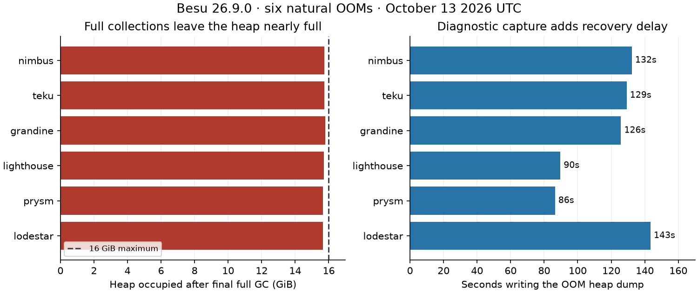

# Besu heap exhaustion recurs on all six pairings

**All six Besu 26.9.0 nodes hit Java heap OOM again on October 13, between 16:27 and 20:21 UTC, after the profiling rollout.** Each wrote a complete heap dump, terminated and restarted. All six were execution-valid at the overnight baseline. These events predate the overnight window; they were discovered during its setup.

This strengthens the existing high-priority [Besu heap exhaustion report](../msf-2-issue-reports-2026-10-13/reports/01-besu-heap-exhaustion.md). The failure crosses all six consensus clients, and the captured final full collections leave **16,016–16,176 MiB occupied out of 16,384 MiB**. The last full-GC pauses lasted **6.14–7.93 seconds**. The evidence supports investigating retained objects and GC roots, rather than attributing the failure solely to short-lived allocation. Allocation sampling alone still cannot identify the retaining owner.

| Pairing | First OOM UTC on October 13 | Heap after last full GC MiB | Last full GC pause | Heap dump duration | OOM to next Besu startup log |
|---|---|---:|---:|---:|---:|
| nimbus-besu-1 | 16:27:44 | 16,112 / 16,384 | 6.16 s | 132.3 s | 135.9 s |
| teku-besu-1 | 16:33:36 | 16,114 / 16,384 | 6.14 s | 129.2 s | 132.9 s |
| grandine-besu-1 | 16:42:06 | 16,176 / 16,384 | 6.37 s | 125.7 s | 133.5 s |
| lighthouse-besu-1 | 16:59:17 | 16,086 / 16,384 | 6.21 s | 89.6 s | 97.3 s |
| prysm-besu-1 | 19:01:56 | 16,032 / 16,384 | 6.49 s | 86.4 s | 90.6 s |
| lodestar-besu-1 | 20:21:02 | 16,016 / 16,384 | 7.93 s | 143.4 s | 146.8 s |

## Captured artifacts

All six private files have a **JAVA PROFILE 1.0.2** HPROF header and match the completed-dump byte counts in the logs: approximately **24.9–25.8 GiB per file**. These serialized file sizes are not retained Java heap sizes. Each failed run also retains 32 JFR files, including checkpoints and repository chunks, and rotated GC logs. File existence and metadata do not establish that every JFR chunk is parseable or that a full heap analyzer has completed successfully.

Current JVM flags confirm **MaxHeapSize=17179869184**, heap dump on OOM and exit on OOM. Dump paths are unique to each JVM run. The incident directories remain under `/data/besu-profiling/runs/` on their respective hosts, and the checkpoint collector excludes directories containing heap dumps from ordinary checkpoint pruning. The public evidence contains paths, sizes, GC tails and timestamps; it contains no raw heap or JFR object data.

## Benchmark impact and next investigation

Dump creation took **86–143 seconds**. The next Besu startup log arrived **91–147 seconds** after the first OOM. This diagnostic interval prolongs recovery compared with immediate termination, so performance and missed-duty analysis must distinguish heap exhaustion, GC stalls and dump collection. Startup is not the time the Engine or consensus client becomes usable again; exact missed duties require the canonical census and Engine logs.

Use one private dump for a class histogram, dominator tree and paths to GC roots, then compare the retaining owner with a second pairing. Correlate the final JFR checkpoints with the exact block and workload preceding each OOM. The newly available heap evidence can confirm or reject the earlier transaction-announcement and RocksDB allocation leads. No historical root cause or profiling-overhead estimate is claimed here.

[Exact OOM and dump logs](evidence/besu-afternoon-oom-logs.json), [host artifact metadata and GC tails](evidence/besu-afternoon-artifacts.json), and [derived table data](evidence/besu-afternoon-summary.json) preserve the source evidence. No additional heap dump, restart or load change was induced by this investigation.
