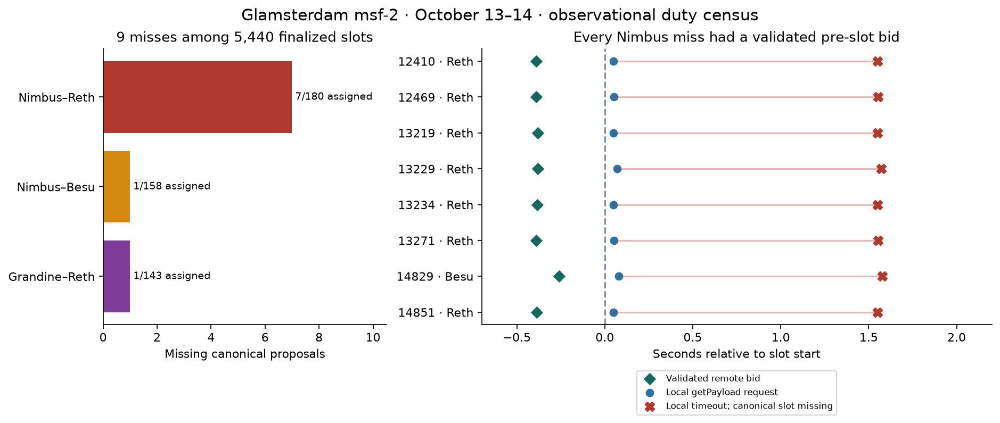
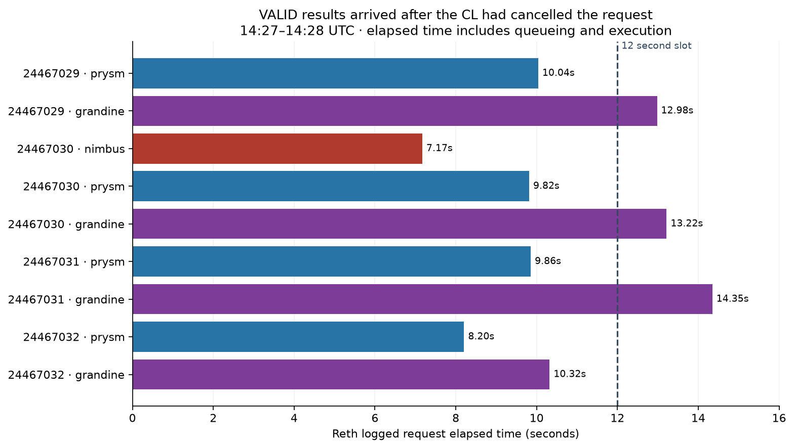
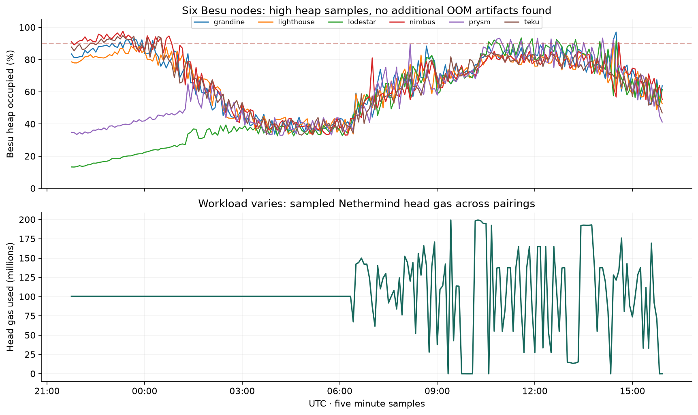

# Glamsterdam msf 2 review through October 14 2026

**The network is finalizing, but proposer fallback remains the main client issue.** From October 13 **21:48:30 UTC** through October 14 **16:11:30 UTC**, the finalized-epoch census found **9 missing canonical proposals among 5,440 slots**. Eight coincide with Nimbus local getPayload timeouts despite validated pre-slot external bids: **7 on Nimbus–Reth and 1 on Nimbus–Besu**. One additional miss affected Grandine–Reth during slow Engine responses. All **36 validator pairings** are synced and execution-valid in the final snapshot, and reference finality advanced **305 → 477**.

The review combines the completed overnight collector with retrospective logs, metrics and canonical proposer data through the current snapshot. This adds **seven misses after 08:00 UTC** to the two overnight misses. The [previous overnight notes](../msf-2-overnight-2026-10-13/README.md) remain the original capture record. No client restart or configuration change was induced during this review.

## Findings worth client team time

| Finding | Owner | Assessment and new evidence |
|---|---|---|
| Remote bid cannot rescue a failed local candidate | Nimbus CL | High priority follow-up. All eight Nimbus misses have a validated bid before the slot and a local timeout about 1.5 seconds after request. The new Besu pairing shows the symptom extends beyond Reth. |
| Late VALID responses after client cancellation | Reth, with Grandine and Prysm interop context | Focused performance follow-up. Nine logged request durations are 7.17–14.35 seconds on three Reth pairings. Exact payload hashes and four canonical blocks preserve the workload. Grandine–Reth missed slot 14824 during this episode. |
| Java heap exhaustion | Besu | No additional OOM observed since the last report. The six October 13 incident dumps remain private and profiling checkpoints are current. Heap samples still reach 91.9–97.7%, so a leak fix is not established. |
| Engine listener remains unresponsive | Nimbus EL | Existing failure remains present. An authenticated read still times out after 10.01 seconds on Nimbus–Nimbus EL, while the Lighthouse–Nimbus EL control answers in 9.62 ms. Ordinary RPC and the process remain available. |
| Payload-body read exceeds server deadline | Besu, Prysm | Lower priority diagnostic lead: one 30-second `engine_getPayloadBodiesByHashV2` timeout, while Prysm continued importing adjacent payloads. No additional missed duty is attributed to this read. |

## Nimbus fallback failure now spans Reth and Besu

The fully finalized census covers **epochs 308–477**. Nimbus–Reth missed **7/180** assigned proposals; Nimbus–Besu missed **1/158**; Grandine–Reth missed **1/143**. The other 33 validator pairings have no missing canonical slots in this census. These are observational duty counts, not a controlled cross-client ranking.

| Slot start UTC on October 14 | Slot | Pairing | Proposer | Correlated failure |
|---|---:|---|---:|---|
| 06:25:00 | 12410 | nimbus-reth-1 | 21850 | Local getPayload timed out after validated remote bid |
| 06:36:48 | 12469 | nimbus-reth-1 | 21631 | Local getPayload timed out after validated remote bid |
| 09:06:48 | 13219 | nimbus-reth-1 | 21563 | Local getPayload timed out after validated remote bid |
| 09:08:48 | 13229 | nimbus-reth-1 | 21008 | Local getPayload timed out after validated remote bid |
| 09:09:48 | 13234 | nimbus-reth-1 | 21441 | Local getPayload timed out after validated remote bid |
| 09:17:12 | 13271 | nimbus-reth-1 | 21045 | Local getPayload timed out after validated remote bid |
| 14:27:48 | 14824 | grandine-reth-1 | 23833 | Engine endpoints exhausted; late VALID responses |
| 14:28:48 | 14829 | nimbus-besu-1 | 15807 | Local getPayload timed out after validated remote bid |
| 14:33:12 | 14851 | nimbus-reth-1 | 21984 | Local getPayload timed out after validated remote bid |

For all eight Nimbus duties, the beacon log validates the external bid before slot start, adds the first bid for that slot and parent, sends local `engine_getPayloadV6`, and logs the timeout. Request-to-timeout intervals are **1.500–1.501 seconds**. The frozen [released-source investigation](../msf-2-issue-reports-2026-10-13/reports/05-nimbus-remote-bid-fallback.md) identifies the local-candidate prerequisite before external selection. This review adds runtime evidence; it does not establish an upstream fix or a fresh private reproduction.

Three useful runtime counterexamples show that external fallback can preserve a proposal after local failure:

| Pairing | Slot | Local timeout UTC | Successful publication UTC | Canonical result |
|---|---:|---|---|---|
| Lighthouse–Reth | 12479 | 06:38:50.019 | 06:38:50.055 | Canonical; builder index 0 |
| Lighthouse–Reth | 13157 | 08:54:26.019 | 08:54:26.054 | Canonical; builder index 0 |
| Lighthouse–Besu | 14812 | 14:25:26.022 | 14:25:26.082 | Canonical; builder index 1 |

Each logs local failure, selection of a builder bid and publication; Dora independently reports the resulting block as canonical. These are separate runtime cases with different deadlines and hardware, not matched experiments. They strengthen the case for a Nimbus regression using an eligible remote bid with a forced local timeout, error or absent candidate, covering integrated and REST proposal callers.

The six Prysm pairings log skipped payload attestations for slots that are already missing canonically. Those messages are downstream evidence of the absent block, not six independent Prysm defects. Similarly, Grandine logs another local construction failure at 14:30:38 for slot 14838, but that slot is canonical: a failed local attempt alone does not prove a lost proposal.

## Reth finishes validation after the consensus request is cancelled

At **14:27–14:28 UTC**, Reth logs nine `Failed to deliver newPayload response, receiver dropped` records whose results are **VALID**, across Grandine–Reth, Prysm–Reth and Nimbus–Reth. Logged elapsed durations are **7.17–14.35 seconds**. Grandine reports exhausted Engine endpoints and fails to produce the payload for missing slot 14824. Nimbus and Prysm also log Engine errors during this interval. These are latency and availability symptoms; no invalid payload or protocol violation is established.

Four canonical payloads anchor a replay:

| Execution block | Gas used | Transactions | Gas limit |
|---:|---:|---:|---:|
| 24467029 | 117,435,886 | 7 | 200,000,000 |
| 24467030 | 149,665,935 | 9 | 200,000,000 |
| 24467031 | 116,118,346 | 7 | 200,000,000 |
| 24467032 | 199,995,900 | 12 | 200,000,000 |

The [block fixture](evidence/reth-delayed-payload-blocks.json) contains exact hashes and public transaction inputs. The elapsed metric includes queueing and execution; it cannot be equated with EVM execution time. The affected Reth hosts have low sampled CPU steal, below 0.06%, and at least 29.8 GiB available memory in the preserved five-minute series. This narrows the evidence but does not isolate CPU saturation, lock contention, storage or queueing.

Reth team follow-up: replay these payloads against the required parent state, trace queue entry, worker start, execution, state-root computation and response delivery, and compare newPayload and local build deadlines separately. Grandine and Prysm traces should identify cancellation budgets. A generic timeout increase could mask missed duty deadlines rather than resolve the delay.

## Besu profiling and the existing observer outage

No new OOM signatures appeared in the bounded log sweep, no new HPROF paths were found, and current container identities and restart counters match the overnight endpoint. The six earlier dumps remain under private incident directories; public evidence exposes paths and sizes only. All six Besu timers are active and their latest checkpoint timestamps were within a five-minute window at the profiling check.

The heap figure uses five-minute samples; it does not establish extrema or uninterrupted health. The workload varies considerably, so improved proposer success and the absence of another OOM cannot be treated as a controlled release or profiling-overhead result. The next Besu investigation remains private dominator-tree and GC-root analysis of the retained OOM dumps, followed by a comparison across pairings.

At **02:31:55 UTC**, Prysm–Besu logs a 30-second server timeout for `engine_getPayloadBodiesByHashV2`, hash `0xf5e4a1434de3a03334e58ffac94c089efd2ef304921c4e6c22e72555b36ee589`. Prysm had imported that payload at 02:31:24, logged a reconstruction `unexpected EOF` at 02:31:25, and continued importing adjacent payloads. This is a useful body-read and cancellation trace for the Besu report, with no demonstrated additional proposer loss. Earlier live JFR checkpoints around this isolated read may have expired under ordinary retention; incident heap directories are exempt from pruning.

The two unstaked Nimbus EL observers retain their earlier optimism. Nimbus–Nimbus EL also reports EL offline, and the independent authenticated `engine_exchangeCapabilities` check times out while the Lighthouse control responds. Do not conflate experimental cold-sync height zero with the separately demonstrated Engine listener outage.

## Coverage and reproducibility

The overnight service completed **611 captures**, including **124 full 41-host snapshots**, then disabled its timer at 08:05 UTC as configured. Finality lag in those samples was two epochs, and no validated/finalized divergence or container lifecycle change was recorded. Current endpoint identities and starts also match the overnight endpoint. The review does not claim continuous direct health sampling after 08:05; it uses retrospective logs, metrics, finalized data and fresh endpoint checks for that interval.

Canonical data excludes partial boundary and unfinalized tail epochs. Every reported missing slot has direct finalized header evidence and a Dora missing result. Disjoint hourly log aggregates avoid double-counting the overnight collector's overlapping query windows. Two ClickHouse memory-limit failures at 03:49 and temporary gateway resets during this review are collection failures, not client defects; successful backfill queries cover those intervals.

The original collector filter missed Nimbus's phrase `Timeout while getting execution payload`. The duty census still found the two overnight misses. This review backfills that phrase across the complete period and records eight matching timeout events; the collector now has the corrected filter and a regression check. No upstream issue or client-team message has been sent.

[Machine readable summary](evidence/review-summary.json), [exact window](window.json), [current 41-host snapshot](evidence/current-network.json), [profiling metadata](evidence/current-besu-profiling.json), [Engine read control](evidence/current-engine-capabilities.json), and [collection evidence](evidence/) preserve the result. Run `python3 summarize.py` and `python3 plot_review.py` here to rebuild statistics and figures without live queries. The collection scripts use authenticated local SSH and Panda configuration; re-running them captures new live evidence.
