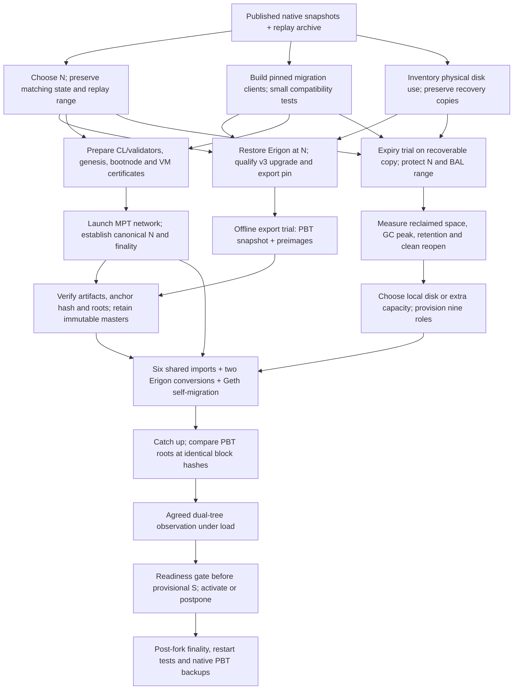

# PBT-1 rehearsal dependencies and history-expiry trial

**Superseded as the execution plan by [PBT-1 experiment](pbt-1-experiment.md).**
This graph and its status statements are historical. In particular, generic
“catch up” below does not establish equal replay coverage across all nine workers.

Updated 2026-10-20. The operator selected the full seven-day experiment at
N=24,453,558. Ansible started a separate original-source restore on the existing
Erigon VM under `/data/pbt-1/rehearsal-24453558`; the final-head source is retained.
Pinned PBT tool compilation and small upstream fixtures have passed. Expiry,
export, full-state migration and network activation have not started.

The operator subsequently requested that we avoid benchmarking every hardware
option. There is no additional VM-shape benchmark gate: choose capacity using
the available evidence and measure actual expiry/migration behavior as we run.
All nine workers now use `so-16vcpu-128gb-intel` in fra1, with 16 vCPUs,
128 GiB RAM and 2,400 GiB local disk. The four existing workers were resized
and five workers were created. Each has an attached recovery volume sized for
its compressed native snapshot: Geth/Besu 1,100 GiB, Nethermind 1,050 GiB and
Erigon 550 GiB. All nine recovery downloads are running. New workers extract
only after archive verification; the original four keep their local databases.
The old empty 2,500 GiB benchmark volume has been deleted.

### First Erigon preparation

**Held after instruction cross-check, before opening the source database.**
The preparation service is disabled and an explicit review marker prevents
manual execution. Downloads continue. See the
[instruction audit](pbt-1-instruction-audit-2026-10-20.md).

The prototype `scripts/pbt/prepare-erigon-anchor.py` had been queued after
recovery archive verification. Its working copy is the separate original source
at `/data/pbt-1/rehearsal-24453558/erigon`. It would replay the verified
1,020-block prefix with the original image under an 8-CPU/32-GiB limit,
check N=24,453,558 and its BAL, then test shutdown/reopen.

Evidence lives in `rehearsal-24453558/anchor-preparation`. A failed attempt is
preserved for inspection and is not automatically retried. This gate does not
establish consensus finality or PBT source-format compatibility. Qualify the
legacy-to-v3 transition and exact export pin before replacing or re-enabling
the prototype, then export
the shared snapshot and preimages. No later-head snapshot substitutes for N.

## Dependency graph



The expiry trial also needs a source of canonical head progress for Besu:
either the live CL-driven network or a qualified Engine API replay harness.
Fresh snap sync specifically depends on a running network, CL forkchoice and
compatible state-serving peers. These are alternative inputs, not a requirement
to wait for all nine workers before testing expiry.

The offline exporter can be tested before network finality. Release its artifacts
for measured migration only after matching their anchor hash against the
finalized chain. Prepare a provisional future `S` before starting online
migration; the final gate decides whether to reach or postpone it.

## What can proceed now

| Work | Dependency / completion evidence |
| --- | --- |
| Erigon pivot feasibility | Inspect preserved checkpoint metadata; qualify restoration at the chosen N, state root and exporter transaction boundary |
| Client builds | Exact commits, dependency hashes, flag validation and small import/expiry fixtures |
| Storage trial design | Allocated bytes by data category, recovery location, copy semantics and sampling script |
| Network configuration | CL/validator allocation, genesis/anchor linkage, fork schedules, bootnode and VM certificate wiring |
| Fleet shape selection | Wait for measured reclamation and peak-space budget; keep 8 CPU and 16/32 GiB limits |
| Full-state migration | Wait for valid artifacts, finality, retained replay data and worker capacity |

Public certificates and platform ingress users/metrics are already integrated.
The VM wildcard issuer, bootnode and actual CL/validator network remain launch
work. A reachable explorer is not evidence that the PBT network is running.

## Pivot choices

| Candidate N | State availability | Prepared replay after N | Use |
| --- | --- | ---: | --- |
| 24,453,558 | Restore original 24,452,538 source and replay 1,020 preparation blocks; qualify the resulting source format | 50,400 blocks / seven chain-days | Preferred full-backlog experiment |
| 24,468,025 | Existing Erigon checkpoint recorded in the previous run; needs clean reopen/export qualification and consumer anchor-state checks | 35,933 blocks / approximately 4.99 chain-days | Optional faster exporter pilot |
| 24,503,958 | Current four-client published snapshots | Zero of the prepared blocks occur after this anchor | Simplest fresh live anchor, but must accumulate a new backlog |

All day conversions here assume the prepared stream's 12-second block interval.
The stored replay archive does not establish CL finality.

The retained Erigon checkpoint is
`/data/pbt-1/checkpoints/erigon-before-maintenance-suppression`.
Its audit records hash
`0x28573936f78bbd655b0487f59cb5c59874197a81c79e05aed09d4e0989d36082`
and MPT root
`0x0037ffe36558ce8f8dc49a34b1819a1c9029ce7eb6e38345b3807c5842cd52b4`.
The checkpoint used hardlinks for immutable files and copied mutable DB files.
Its apparent size is not wholly additional physical space; do not sum separate
`du` traversals or delete shared files as a shortcut.

For the seven-day route, establish how every import client accesses/verifies N;
having a final-head database does not prove historical MPT state remains
available. Fresh snap sync at the final head does not solve this dependency.

Erigon source candidate inspected:
`372df0e68f52f9975370bff38dee6e41aefff0d7` on `binary-trie`.
The exporter uses the persisted commitment checkpoint and checks its transaction
number against the end of the block. It is not an arbitrary historical-state
export command. The converter requires suitable v3 hex commitment state and a
separate empty output directory. Qualify these boundaries on a small fixture
before upgrading the full source. See the
[export pin implementation](https://github.com/erigontech/erigon/blob/372df0e68f52f9975370bff38dee6e41aefff0d7/cmd/utils/app/export_pin.go)
and [conversion implementation](https://github.com/erigontech/erigon/blob/372df0e68f52f9975370bff38dee6e41aefff0d7/cmd/integration/commands/commitment_convert_pbt.go).

## History expiry: findings and trial

Expire old blockchain history while preserving the migration anchor, current
state, and all required blocks/BALs. State-history pruning, blockchain-history
expiry and removal of Nethermind's obsolete Patricia database are different
operations. The Patricia cleanup is already complete.

### Besu

At the supplied Besu commit `39377a2659f63c3bb230a5f57b4ef6846348f876`:

- `1,310,000` retained blocks is about 182 days at 12 seconds.
- `113,056` retained BALs is about 15.7 days.
- The default retained minimum is `14,299 * 32 = 457,568`.
  Startup validation rejects the supplied BAL value unless the minimum is
  explicitly lowered. This is verified from source, not a binary execution.
  See [configuration constants](https://github.com/matkt/besu/blob/39377a2659f63c3bb230a5f57b4ef6846348f876/ethereum/core/src/main/java/org/hyperledger/besu/ethereum/chain/ChainPrunerConfiguration.java)
  and [startup validation](https://github.com/matkt/besu/blob/39377a2659f63c3bb230a5f57b4ef6846348f876/app/src/main/java/org/hyperledger/besu/cli/BesuCommand.java).
- Pruning is scheduled on canonical head progress, including the snap-sync
  import path. A stopped-head restart alone is not a history-draining procedure.
  The implementation batches work at up to three times the configured
  frequency: `2048` permits at most `6144` blocks per job. Actual reclamation
  can lag deletion because RocksDB must reclaim obsolete storage.
  See [ChainDataPruner](https://github.com/matkt/besu/blob/39377a2659f63c3bb230a5f57b4ef6846348f876/ethereum/core/src/main/java/org/hyperledger/besu/ethereum/chain/ChainDataPruner.java).

Initial trial configuration: keep the supplied six-month block window and GC
settings, but retain **457,568 BALs** while qualifying the build. This respects
the source default minimum and avoids sacrificing the migration interval.

```text
--Xchain-pruning-enabled=ALL
--Xchain-pruning-blocks-retained=1310000
--Xchain-pruning-bals-retained=457568
--Xchain-pruning-frequency=2048
--Xplugin-rocksdb-blockchain-blob-garbage-collection-enabled=true
--Xplugin-rocksdb-blob-garbage-collection-age-cutoff=0.75
--Xplugin-rocksdb-blob-garbage-collection-force-threshold=0.1
```

The GC flags exist in the
[pinned RocksDB options](https://github.com/matkt/besu/blob/39377a2659f63c3bb230a5f57b4ef6846348f876/plugins/rocksdb/src/main/java/org/hyperledger/besu/plugin/services/storage/rocksdb/configuration/RocksDBCLIOptions.java).
The team's 500–600 GiB post-expiry estimate is an estimate, not a measurement of
our database. Measure both deletion progress and actual filesystem free space.

A seven-day-old anchor plus fourteen days of observation already spans 21 days,
before preparation and retry margin. Size the retention window against the
maximum age of the oldest required block, including any accelerated replay;
keep the external replay archive regardless.

A new SNAP sync is a separate fallback experiment, not an offline pruning
command. Use a checkpoint hash/number/total difficulty from this fork, with a
qualified peer and CL. Do not blindly copy the supplied mainnet total difficulty.
Also verify that the fresh DB retains the state and BALs required by the chosen N.

### Geth

The current `pbt` branch head is
`84a12eff96347929ab62b65cfeb1194478445518`, newer than our recorded
`4f7e4b23c066932bbd399bce94955468d6039bac` build candidate.
[PR #69](https://github.com/CPerezz/go-ethereum/pull/69) merged on October 20
and compresses scratch, punches consumed file ranges and consumes online input
artifacts by default. Its peak-space projections are not full-scale PBT-1
measurements. Qualify this candidate before promoting the recorded build pin.

Give each Geth import/self-migration worker its own disposable input files.
Keep immutable masters remotely or on recovery storage. Never hardlink the
consumable input files to masters or other workers: hole punching and truncation
would alter the shared inode. Validate recovery after interrupted consumption.
`--pbt.import.keep-artifacts` preserves the inputs but changes the disk budget.

The inspected source supports offline `prune-history` with `postmerge` or
`postprague` boundaries, keyed to known genesis hashes and checked against the
expected cutoff block hash. This is not a generic six-month rolling cutoff.
Verify this fork's genesis and historical hash before selecting it.
`--history.state` and `--history.transactions` do not substitute for body/receipt
expiry. See [history policies](https://github.com/CPerezz/go-ethereum/blob/84a12eff96347929ab62b65cfeb1194478445518/core/history/historymode.go)
and [offline command](https://github.com/CPerezz/go-ethereum/blob/84a12eff96347929ab62b65cfeb1194478445518/cmd/geth/chaincmd.go).

### Nethermind and Erigon

Nethermind `pbt-state` candidate
`f4e295193e426230547c59dcdb8decb25d725418` exposes
`History.Pruning=Rolling`, `History.RetentionEpochs` and
`History.BalRetentionEpochs`, constrained by chainspec minima.
Its history pruner also depends on a usable sync pivot and initialized deletion
progress. Inspect those values on our restored DB before proposing a command.
This has not been built or tested here.
See [history configuration](https://github.com/NethermindEth/nethermind/blob/f4e295193e426230547c59dcdb8decb25d725418/src/Nethermind/Nethermind.History/IHistoryConfig.cs)
and [history pruner](https://github.com/NethermindEth/nethermind/blob/f4e295193e426230547c59dcdb8decb25d725418/src/Nethermind/Nethermind.History/HistoryPruner.cs).

For Erigon, qualify expiry after the exporter/pivot recovery path is established.
Its block, state-history and commitment-history policies differ, and the
prepared source had special BAL retention/backfill work. Do not delete snapshot
segments by hand or assume changing a prune mode immediately shrinks an existing
database. See [pruning modes](https://github.com/erigontech/erigon/blob/372df0e68f52f9975370bff38dee6e41aefff0d7/db/kv/prune/storage_mode.go).

## Measurement gates before choosing storage

Read-only checks during this review found approximately 626 GB available on
Erigon's root filesystem and 557 GB on Besu's, in decimal bytes. The attached
Besu recovery/benchmark volume has about 2.529 TB available. These are actual
available-space readings; the nominal 1800-GiB device capacity is not free space.

1. Record allocated bytes for state, history, indexes, artifacts and recovery
   files. Identify hardlinks, sparse files and filesystem boundaries.
2. Run expiry on a recoverable working copy; measure deletion rate, compaction/
   blob-GC peak disk usage, I/O and time to steady physical reclamation.
3. Cleanly restart. Verify head hash/state root, N requirements and complete
   retrieval of the protected BAL/body interval.
4. Run one full migration per client with peak-space sampling. Include source
   DB, PBT growth, transient scratch, working artifacts, CL growth and logs.
   Do not add quoted scratch and PBT estimates without checking whether they
   already overlap in the measured peak.
5. Choose local storage if measured peak plus an explicit operating reserve
   fits. Otherwise place data on larger local storage or a volume consistently
   for both memory variants; rerun the performance baseline.

Use the existing volume first for recovery or temporary trial copies where
appropriate. Do not assume scratch can be moved across filesystems: Erigon's
conversion uses hardlinks, and Besu staging also needs filesystem qualification.
Retain independent masters and account for the cost of restoring from them.

## First execution batch

1. Qualify Erigon's source-format upgrade and export pin on a small fixture.
2. Restore source block 24,452,538 separately and replay the verified 1,020-record
   prefix to N=24,453,558. The later-checkpoint alternative is not selected.
3. Build the exact Besu/library pair and new Geth candidate; test startup flags
   and interrupted-import recovery.
4. Prepare the Besu expiry trial using canonical head advancement and the
   corrected BAL retention. Measure it before selecting the nine-worker disks.
5. Prepare the minimal CL/validator network and finality linkage in parallel.

The full rehearsal still follows the
[upstream plan](https://github.com/misilva73/pbt-planning/blob/main/outreach/pbt-mainnet-fork-migration-test-plan.md)
and [local process](pbt-1-migration-process.md), including the two-week
observation reference until explicitly revised.

## Active preparation evidence

- Restore play: `ansible/pbt-erigon-rehearsal-seed.yaml`; runtime container
  `pbt-1-erigon-rehearsal-snapshot` on `164.92.239.96`. Ansible completed with
  zero failures; chunk progress confirmed.
- Source archive: 276,341,609,865 bytes, expected unpacked data
  428,144,697,343 bytes. Download uses an object-scoped signed URL; account
  credentials stay on the controller.
- The 1,020-record preparation prefix passed number/parent continuity checks.
  SHA-256 over its ordered compressed records:
  `822629d9718ca6dad8cbdc7056acd98bffcb2f8a3cc0749f96ea6e4e426e8109`.
- Selected N hash:
  `0x331c54fd1b37302697157dec30d2a1e0a13682843301f60d8ebac004f8bc4155`.
  MPT root:
  `0x90fe96f02a1d1009e48ccfb82d15bdf5aa130907acd6c4ebe2f2624e5a911260`.
- Native tool build: `scripts/pbt/build-rehearsal-erigon.py`, exact commit
  `372df0e68f52f9975370bff38dee6e41aefff0d7`. The first bootstrap detected that
  a previously cached archive labelled Go 1.26 actually contained Go 1.23.6.
  That attempt and logs were preserved; the retry uses the controller's verified
  Go 1.26 toolchain with an archive checksum and version check.
- Read-only monitor: `scripts/pbt/monitor-rehearsal.py`; reports under
  `~/.local/state/pbt-1-run/rehearsal/`. Restore completion does not automatically
  authorize conversion; verify the reopened source and available space first.
